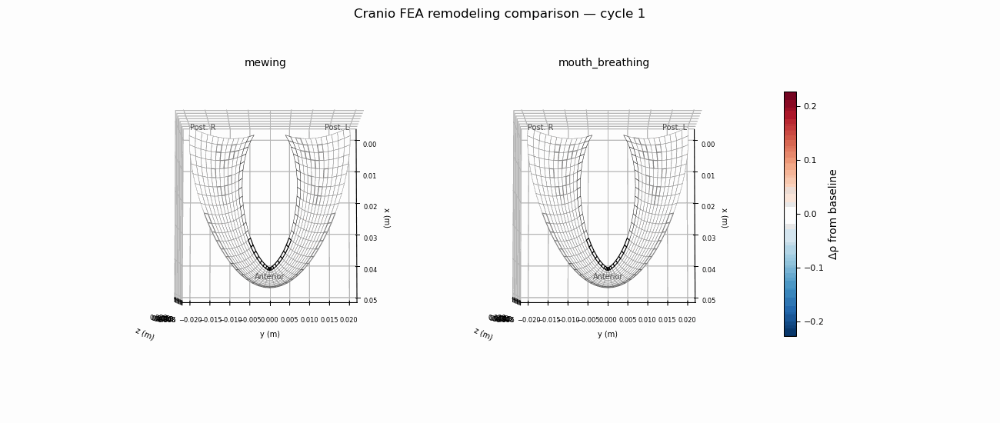

# Cranio-Facial FEA: Adolescent Bone Remodeling Under Tongue Posture

A computational pipeline that models how sustained tongue-on-palate posture ("mewing") versus mouth breathing influences adolescent maxillary bone density over time, using finite element analysis and Huiskes strain-adaptive remodeling.

> **This is a mechanobiological hypothesis explorer, not a clinical predictor.**
> All outputs are comparative and directional. See [docs/SCIENTIFIC_CAVEATS.md](docs/SCIENTIFIC_CAVEATS.md) for full limitations.

---

## Density Evolution: Mewing vs. Mouth Breathing



*Left: mewing (2 kPa sustained tongue load). Right: mouth breathing (gravity only, no palatal load). Color = bone relative density; 12 remodeling cycles.*

---

## Key Results

| Scenario | 12-Cycle Density Trend | Interpretation |
|----------|----------------------|----------------|
| **Mewing** (2 kPa tongue load) | &rho; rises from 1.00 &rarr; 1.04 (55% apposition, 15% resorption) | Mechanical stimulus drives net bone formation |
| **Mouth breathing** (gravity only) | &rho; decays from 1.00 &rarr; 0.99 (100% resorption) | Disuse-driven resorption under absent palatal load |

The divergence is consistent with Wolff's law and the mechanostat hypothesis: loaded bone strengthens, unloaded bone weakens.

---

## Method

### Geometry

An analytic U-shaped maxillary arch mesh (2,925 nodes, 2,112 C3D8 hexahedral elements) with five material zones:

- **Cortical bone** (746 elements) — surface layers, E = 15 GPa
- **Cancellous bone** (746 elements) — interior layers, E = 0.5 GPa
- **Tooth root dentin** (340 elements) — anatomical tooth positions, E = 20 GPa
- **Midpalatal suture** (176 elements) — compliant midline zone, E = 50 MPa
- **Lateral sutures** (104 elements) — bilateral compliant zones, E = 50 MPa

Arch dimensions: 48 mm depth, 38 mm width, 13 mm palatal vault, 3 mm bone thickness. The geometry is parametrically generated (not CT-derived) with anatomical features including palatal vault curvature, alveolar ridge elevation, posterior arm flare, and variable bone thickness.

### Loading

- **Surface-normal pressure**: tongue force acts perpendicular to the curved palatal surface at each node (area-weighted normals from adjacent element faces)
- **Anterior-posterior gradient**: anterior palate receives 2.5x the pressure of the posterior palate, modeling real tongue-tip contact patterns
- **Gravity body force**: self-weight loading on all elements via mass-consistent density cards
- **Muscle loading** (optional): bilateral jaw-muscle resultant forces for load-case sensitivity studies

### Solver

[CalculiX](http://www.dhondt.de/) linear static solver (C3D8 elements, isotropic elastic materials). Each remodeling cycle runs a full FEA solve, extracts element-level strain energy density from CalculiX ENER output, then updates density.

### Remodeling Law

Huiskes lazy-zone SED-stimulus bone remodeling ([Huiskes et al., 1987](https://doi.org/10.1016/0021-9290(87)90030-3)):

```
SED = true strain energy density (from CalculiX *EL PRINT ENER)
stimulus = (SED / SED_ref) - 1
if stimulus >  s:  drho = alpha_app * (stimulus - s)    [apposition]
if stimulus < -s:  drho = alpha_res * (stimulus + s)    [resorption]
else:              drho = 0                              [lazy zone]
rho(t+1) = clamp(rho(t) + drho, [rho_min, rho_max])
E(t+1) = E_base * rho(t+1)^n
```

Per-layer homeostatic SED setpoints (cortical vs. cancellous) and per-layer Carter-Hayes power law exponents (n=3 cortical, n=2 cancellous). Suture elements undergo strain-dependent modulus softening. Tooth root elements are held at fixed density.

---

## Quick Start

### Prerequisites

- **Python 3.8+** with `pip install -r requirements.txt`
- **CalculiX** (`ccx`) in `PATH` — `sudo apt install calculix-ccx` on Ubuntu/WSL

### Run the Full Pipeline

```bash
./scripts/reproduce_all.sh
```

This runs mesh generation, all solver cases, field extraction, remodeling loop, animations, and post-processing in sequence.

### Step-by-Step

```bash
python3 mesh/build_mesh.py              # Generate mesh (mesh/mesh_data.json)
python3 solver/make_inp.py              # Generate CalculiX .inp decks
./solver/run_case.sh mewing             # Solve a single case
python3 post/extract_fields.py          # Extract displacement + stress + SED fields
./scripts/remodeling_loop.sh            # 12-cycle remodeling (mewing + mouth_breathing)
python3 post/make_animation.py          # Generate density evolution GIFs
```

### Outputs

- `results/comparison_animation.gif` — side-by-side mewing vs. mouth-breathing density evolution
- `results/<scenario>/density_evolution.gif` — per-scenario animation
- `results/remodeling_summary.csv` — density statistics per cycle
- `results/metrics_summary.csv` — displacement and stress peaks per load case
- `results/mesh_quality_summary.json` — element quality metrics (Jacobian, aspect ratio)

---

## Project Structure

```
configs/          Configuration files (geometry, materials, loads, remodeling params)
mesh/             Mesh generator and mesh_data.json
solver/           CalculiX input deck generator, solver wrapper, .inp files
post/             Post-processing: field extraction, remodeling engine, visualization
scripts/          Pipeline runners, sensitivity sweeps, mesh quality checks
docs/             Specifications, roadmap, scientific caveats
results/          Generated outputs (gitignored except comparison GIF; reproduced via pipeline)
```

### Load Cases

| Case | Tongue (kPa) | Muscle (N) | Purpose |
|------|-------------|-----------|---------|
| `mewing` | 2.0 | 0 | Remodeling study: sustained tongue posture |
| `mouth_breathing` | 0.0 | 0 | Remodeling study: absent palatal load (gravity only) |
| `low/medium/high_kpa` | 0.5 / 2.0 / 5.0 | 0 | Single-shot load comparison |
| `*_plus_muscle` | 0.5–5.0 | 2–8 | Tongue + jaw muscle combined loading |

---

## Mesh Quality

The v2 mesh passes all quality checks (run `python3 scripts/mesh_quality_report.py`):

| Metric | Value |
|--------|-------|
| Elements | 2,112 (C3D8 hex) |
| Negative Jacobians | 0 |
| Aspect ratio (P95) | 3.74 |
| Scaled Jacobian (mean) | 0.94 |

---

## Limitations

This model is intentionally simplified to explore the **directional hypothesis** that tongue posture affects maxillary bone remodeling. Key limitations:

- Geometry is analytic (not CT-derived) — stress magnitudes are not anatomically calibrated
- Material is isotropic linear elastic (cortical/cancellous split by layer position, not microstructural anisotropy)
- Remodeling parameters are from hip/spine literature, not validated for craniofacial bone
- Suture biology is modeled as mechanical compliance only, not cellular response
- Mouth-breathing scenario includes only gravity — no baseline masticatory loading

For a thorough discussion, see [docs/SCIENTIFIC_CAVEATS.md](docs/SCIENTIFIC_CAVEATS.md).

---

## Future Directions

- CT-derived mesh from open-source maxillary scan data
- FEBio or nonlinear solver integration for large-deformation suture mechanics
- Transversely isotropic cortical bone material model
- Baseline masticatory loading for the mouth-breathing comparison
- Parameter sensitivity dashboard across remodeling constants

---

## References

1. Huiskes, R., et al. (1987). Adaptive bone-remodeling theory applied to prosthetic-design analysis. *J. Biomechanics*, 20(11-12), 1135-1150.
2. Carter, D.R. & Hayes, W.C. (1977). The compressive behavior of bone as a two-phase porous structure. *J. Bone Joint Surg.*, 59(7), 954-962.
3. Frost, H.M. (2003). Bone's mechanostat: A 2003 update. *Anat. Rec.*, 275A(2), 1081-1101.
4. Mew, J.R.C. (2004). The postural basis of malocclusion: A philosophical overview. *Am. J. Orthod. Dentofac. Orthop.*, 126(6), 729-738.
5. Proffit, W.R. (1978). Equilibrium theory revisited. *Angle Orthod.*, 48(3), 175-186.

---

## License

This project is provided for educational and research purposes. Not for clinical use.
