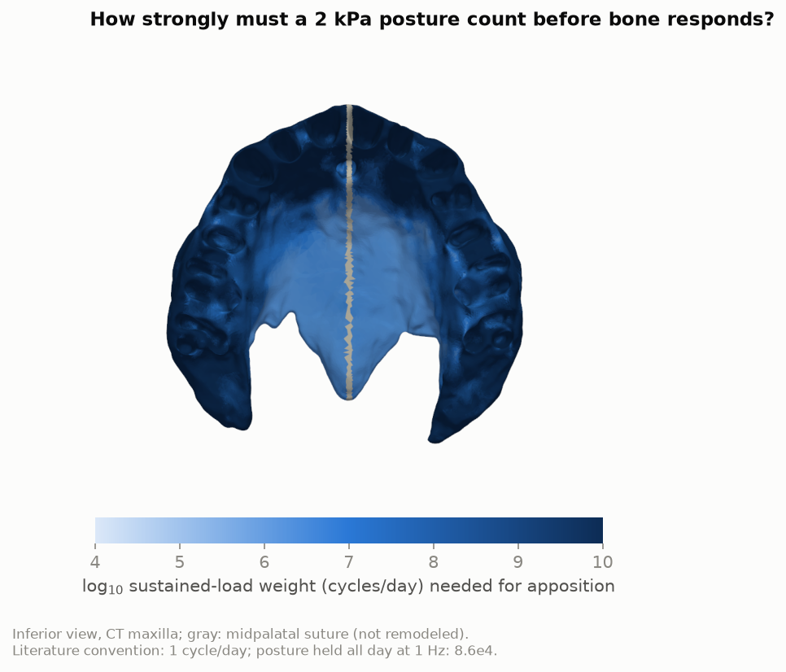
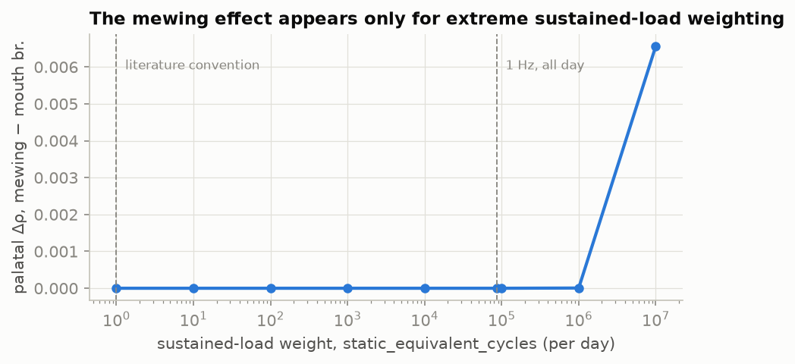
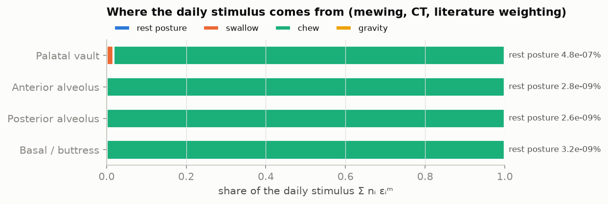
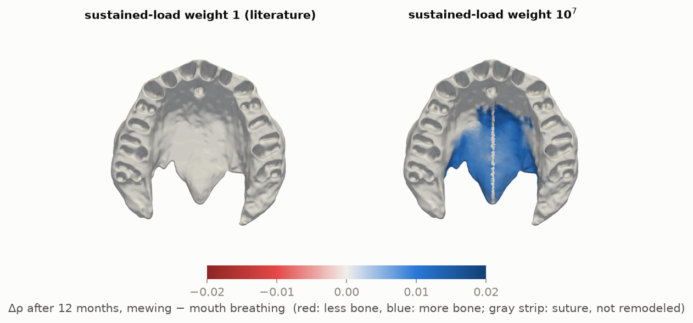
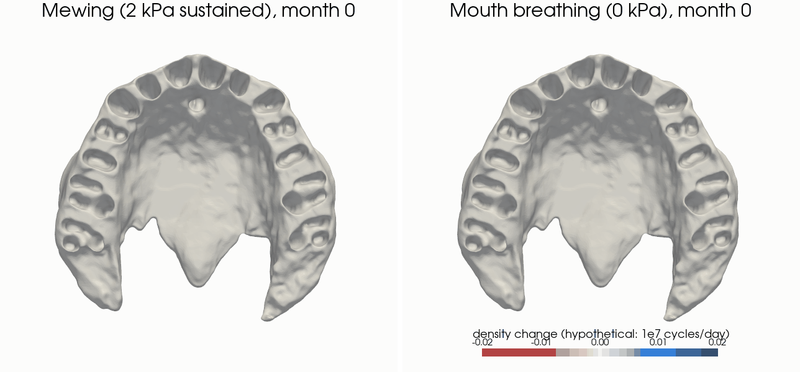

# craniofea — does tongue posture remodel the adolescent maxilla?

[](https://github.com/Wesley-Jakob-Gilbert/Cranio-Facial-FEA/actions/workflows/ci.yml)


A verified, differentiable finite-element and bone-remodeling pipeline for a
CT-derived human maxilla, built to test one popular claim mechanistically:
that sustained tongue-on-palate posture ("mewing") strengthens the maxilla,
while mouth breathing (tongue low) weakens it.

> **Hypothesis explorer, not a clinical predictor.** Every result is relative
> to a reference habit and depends on stated assumptions; see
> [docs/METHODS.md](docs/METHODS.md) §8 for limitations.

## Key finding

Under a literature-calibrated daily-stimulus remodeling model
(Carter/Beaupré, m = 4) on the Open-Full-Jaw patient-3 maxilla, a 2 kPa
sustained posture **changes bone density nowhere**: the palate's daily
mechanical stimulus is dominated by ~600 swallows and ~1,500 chewing cycles,
and a static load counts as one cycle per day. Mewing and mouth breathing
are indistinguishable.

The effect appears only if each day of sustained posture is counted as at
least **5 × 10<sup>5</sup> load cycles** (first responding element in the
palatal vault) and about **7 × 10<sup>6</sup>** for half of the vault: 6 to
80 times more than holding the posture all day at 1 Hz would represent. The
model therefore turns a vague claim into a sharp, falsifiable question: *is a
static palatal pressure about a million times more osteogenic per day than
current evidence on static loading suggests?*

<p align="center">
  
  
</p>

| CT maxilla, 12 months | literature weighting (1 cycle/day) | hypothetical 10<sup>7</sup> cycles/day |
|---|---|---|
| Palatal vault mean Δρ, mewing | **0** (max \|S\| = 9 × 10<sup>-8</sup> vs lazy zone 0.1) | +0.0065 |
| Palatal vault mean Δρ, mouth breathing | **0** | 0 |
| Share of the palatal daily stimulus from the resting posture | 5 × 10<sup>-7</sup> % | 4.6 % (volume average over the vault) |
| Reference habit (homeostasis check) | \|S\| ≤ 1.4 × 10<sup>-10</sup> | — |

Mouth breathing never resorbs bone in this model: removing a 0.2 kPa resting
load is negligible next to swallowing and chewing, which dominate the daily
stimulus everywhere, including the palate (98 % from chewing at literature weighting; figure below).

<p align="center"></p>

<p align="center">
  
</p>

<details>
<summary>Animation: what the hypothesis would predict at 10<sup>7</sup> cycles/day (hypothetical)</summary>
<p align="center"></p>
</details>

## What is in the repository

| Component | What it does | Evidence |
|---|---|---|
| **JAX FE solver** (`craniofea.fem`) | Linear-elastic tet4, vectorised JAX kernels, AMG-preconditioned CG with rigid-body deflation for 17 GPa / 10 MPa contrast, implicit-adjoint gradients (`jax.grad` through the solve) | Patch test exact to 1e-14; O(h²) displacement / O(h) stress convergence (Lamé, self-weight); adjoint vs finite differences 2e-9; 840k tets solved in ~30 s on a laptop CPU — [VERIFICATION.md](docs/VERIFICATION.md) |
| **CalculiX & FEBio backends** (`craniofea.backends`) | Same `Problem` written to `.inp` / `.feb` (per-element anisotropic materials, per-face pressures, gravity), run, parsed back | Agreement with the reference solver: CalculiX ~1e-7, FEBio O(strain) — [BACKENDS.md](docs/BACKENDS.md) |
| **CT pipeline** (`craniofea.mesh`, `craniofea.data`) | Downloads Open-Full-Jaw with checksums, separates bone from teeth/PDL, detects the anatomical frame, labels palate, tooth sockets, buttress fixation, cortical shell, midpalatal suture and reporting regions | [MESH.md](docs/MESH.md) |
| **Remodeling model** (`craniofea.remodel`) | Daily loading history (resting posture, swallowing, chewing, gravity) → daily strain stimulus → site-specific homeostatic setpoint → lazy-zone density evolution | Every parameter sourced with a confidence rating — [METHODS.md](docs/METHODS.md) |
| **Sensitivity analysis** | Analytic per-element threshold, static-weighting sweep, Morris screening over 14 uncertain inputs | `scripts/reproduce_results.py` |

<p align="center">
  
</p>

## Model in one screen

For each element and each daily load event *i* (cycles nᵢ per day, from an
FE solve), with strain energy density Uᵢ and isotropic-equivalent modulus E:

```
effective strain     εᵢ = sqrt(2 Uᵢ / E)
daily stimulus       Ψ  = ( Σᵢ nᵢ εᵢ^m )^(1/m)          m = 4; sustained events use n = static_equivalent_cycles
setpoint             Ψ* = Ψ under the reference habit at ρ = 1   (site-specific homeostasis)
error                S  = Ψ/Ψ* − 1, smoothed element → node → element
density rate         dρ/dt = c (S ∓ w) outside the lazy zone |S| ≤ w, else 0
stiffness            E = E_layer · ρ^n_layer   (cortical n = 3, orthotropic, surface-aligned; cancellous n = 2)
```

Scenarios differ only in resting palatal pressure: reference 0.2 kPa,
mewing 2 kPa, mouth breathing 0 kPa; swallowing (15 kPa, 600/day) and
chewing (100 N, 1,500/day) are shared. Because the setpoint is calibrated on
the reference habit, the reference scenario is exactly homeostatic
(|S| ≤ 1e-10 on the CT mesh), and no global setpoint is hand-tuned.

## Quick start

```bash
git clone https://github.com/Wesley-Jakob-Gilbert/Cranio-Facial-FEA && cd Cranio-Facial-FEA
pip install -e ".[dev,viz]"            # add [gpu] for CUDA JAX, [remesh] for gmsh/fTetWild

pytest -m "not slow"                    # ~200 tests, no data or external solvers needed
craniofea study configs/study_template.yaml   # parametric arch, 1-2 minutes on a laptop CPU
```

Full CT reproduction (about 4 h on a laptop CPU):

```bash
python -m craniofea.data                # fetch Open-Full-Jaw patient 3 (280 MB, sha256-verified)
python scripts/build_meshes.py ct       # bone mesh, labels, quality report
python scripts/reproduce_results.py     # CT studies, thresholds, sensitivity
python scripts/make_figures.py          # figures in docs/figures/
```

Optional cross-verification: `apt install calculix-ccx`, and
`scripts/install_febio.sh` builds FEBio 4 from source; then `pytest -m "calculix or febio"`.

## Repository layout

```
src/craniofea/
  model.py        data contract: Mesh, Material, LoadCase, Problem, Solution
  fem/            JAX solver, constitutive laws, reference solver, verification problems
  backends/       CalculiX and FEBio writers, runners, readers
  mesh/           CT import, frame detection, labeling, template arch, quality, remeshing
  remodel/        loading history, stimulus, remodeling law, studies, sensitivity
  materials.py    tissue layers + density -> per-element stiffness
  viz/            off-screen rendering and animations
configs/          study and mesh configurations (all parameters documented)
docs/             METHODS, VERIFICATION, MESH, BACKENDS, ARCHITECTURE
scripts/          mesh building, verification, benchmarks, result reproduction, figures
tests/            unit, verification and cross-solver tests
```

## Limitations

Linear elasticity on a fixed adult-derived geometry; no growth, no sutural
biology, no soft-tissue or airway effects; the maxilla is clamped at its
buttress cuts; loading magnitudes for deliberate tongue posture and chewing
are weakly constrained. The central unknown, how osteogenic a sustained load
is, has no measured value for human craniofacial bone — the model makes the
dependence explicit rather than resolving it. Details in
[METHODS.md §8](docs/METHODS.md#8-limitations) and [MESH.md](docs/MESH.md).

## History

Version 0.2 replaces an earlier script-based CalculiX pipeline. A review in
October 2026 found that it hand-tuned its setpoints, leaked state between
scenarios, wrote an orthotropic material card in the wrong format (a
non-positive-definite cortex), and meshed teeth and PDL as bone. Its results
were withdrawn; nothing from it is reused here.

## Data, licences and citation

Code: MIT ([LICENSE](LICENSE)). The CT geometry comes from
[Open-Full-Jaw](https://github.com/diku-dk/Open-Full-Jaw) (Gholamalizadeh et
al., *Comput Methods Programs Biomed* 224:107009, 2022,
doi:[10.1016/j.cmpb.2022.107009](https://doi.org/10.1016/j.cmpb.2022.107009)),
licensed CC BY-NC-SA 4.0. It is downloaded on demand and never
redistributed. Figures rendered from it (`docs/figures/mesh_labels.png`,
`docs/figures/result_*`) are derivative works under CC BY-NC-SA 4.0.

If you use this software, please cite it via [CITATION.cff](CITATION.cff).
