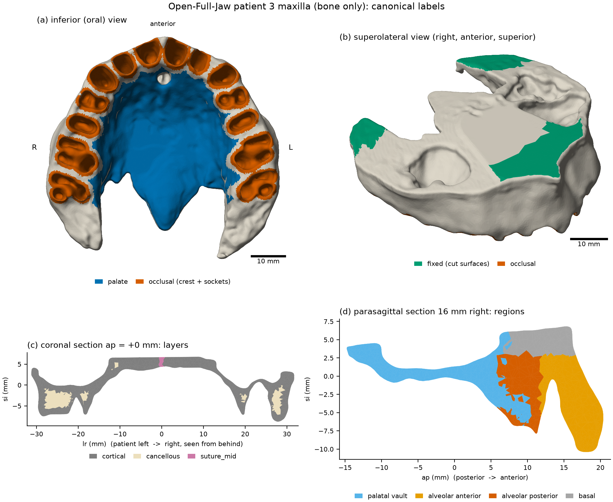
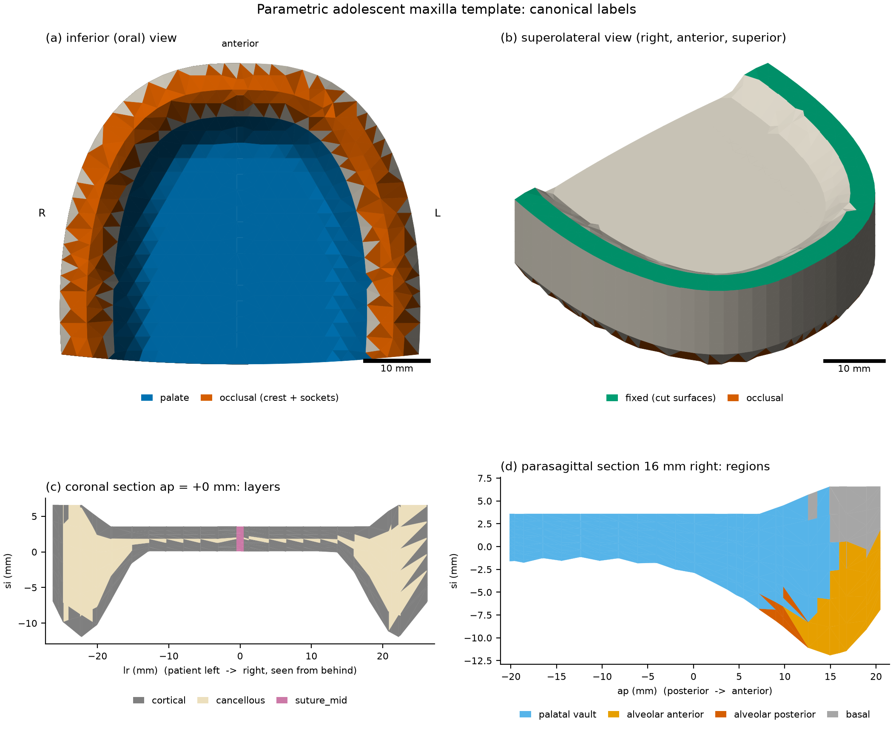

# Meshes and anatomical labels

`craniofea.mesh` produces two kinds of maxilla meshes that share **one
labeling contract** (the canonical labels of [ARCHITECTURE.md](ARCHITECTURE.md)),
so that loading, materials and reporting are mesh-agnostic:

| mesh | source | size | used for |
|---|---|---|---|
| CT | Open-Full-Jaw patient 3, bone of the maxilla | 106 k nodes, 421 k tets | patient-specific analyses |
| CT remesh | fTetWild / gmsh re-mesh of the CT surface (`mesh/remesh.py`) | see below | mesh-convergence studies (not yet produced for patient 3) |
| template | parametric adolescent maxilla | 3.3 k nodes, 15 k tets | tests, CI, demos (no data needed) |

```bash
python -m craniofea.data --patient 3            # download + sha256 check (or --from-local PATH)
python scripts/build_meshes.py all              # template, CT, remeshes, quality, figures
# or step by step: template | ct | remesh | quality | figures
```

All outputs are written to `data/derived/` (git-ignored).

## Source data and license

**Open-Full-Jaw** (Gholamalizadeh et al., "Open-Full-Jaw: An open-access
dataset and pipeline for finite element models of human jaw",
*Comput. Methods Programs Biomed.* 224:107009, 2022) provides 17
CBCT-derived jaw models. Each patient is a git-LFS archive in
[diku-dk/Open-Full-Jaw](https://github.com/diku-dk/Open-Full-Jaw). Note that
`raw.githubusercontent.com/.../Patient_3.zip` returns only the 134-byte LFS
*pointer*; the archive is served from

```
https://media.githubusercontent.com/media/diku-dk/Open-Full-Jaw/72b967df7943e97c84d5ac63fae85cf81ab76cb7/dataset/Patient_3.zip
```

(280,633,063 bytes, sha256 `efb5b690...61e9a4`, identical to the oid in the
LFS pointer). `craniofea.data` pins this commit, stores the sha256/size of
all 17 archives (taken from their LFS pointers), rejects LFS pointer files
with an explanatory error, verifies every archive and extracts only the
three members the pipeline needs (maxilla volumetric mesh, pipeline
parameter log, teeth axes).

> **License.** The dataset is licensed **CC BY-NC-SA 4.0** (attribution,
> non-commercial, share-alike). Meshes derived from it are never committed
> to this repository; `data/` is git-ignored. The CT panels of
> `docs/figures/mesh_labels.png` are adapted from Open-Full-Jaw and are
> therefore themselves under CC BY-NC-SA 4.0, unlike the MIT-licensed code.

### The volumetric mesh

`Patient_3/output/maxilla/volumetric_meshes/maxilla_volumetric_mesh.msh`
(gmsh 2.2, millimetres) is one conforming tet4 mesh of 184,617 nodes and
853,068 tets with shared nodes on all interfaces. The gmsh *geometrical*
tag identifies the tissue (the physical tag is 0 everywhere):

| tag | tissue | tets | nodes | volume | evidence |
|---|---|---:|---:|---:|---|
| 1 | teeth | 292,787 | 77,526 | 9,103 mm³ | 14 closed bodies whose crowns extend 11 mm below the bone |
| 2 | PDL | 139,502 | 48,184 | 511 mm³ | shell between tags 1 and 3; 45,483 faces shared with bone and 46,434 with teeth; mean thickness 0.20 mm in the pipeline log |
| 3 | bone | 420,779 | 106,452 | 15,877 mm³ | one connected body; never touches the teeth directly |

The pipeline keeps the **bone** (configurable: `source.keep`) and exposes the
tooth sockets as free surfaces. The bone faces shared with the PDL are kept
as the extra surface set `socket`, an exact representation of the socket
walls (lamina dura) through which occlusal load reaches the bone. The
importer (`mesh/ct.py`) converts to metres, removes degenerate tets
(normalised volume < 1e-6; none in patient 3), orients every tet
positively (none needed flipping) and drops unused nodes.

Coordinates are DICOM patient coordinates (LPS): +x patient left,
+y posterior, +z superior. This is confirmed independently by the teeth-axes
file: the left lateral incisor (universal #10) lies at x = +11.3 mm and the
right second molar (#2) at x = -26.3 mm.

## Anatomical frame (`mesh/frame.py`)

`detect_frame` recovers `lr` (left -> right), `ap` (posterior -> anterior)
and `si` (inferior -> superior) from shape alone, using points sampled
uniformly in the volume (so the result does not depend on mesh density):

1. **si axis**: the smallest principal axis of inertia. The maxilla is
   plate-like (variance ratio 0.07 for patient 3); this axis is the normal of
   the bone's palatal/occlusal plane.
2. **lr axis**: the in-plane normal of the best mirror-symmetry plane
   (scan in 2 deg steps, refined to 0.25 deg; mean nearest-neighbour residual
   0.60 mm vs 2.9 mm for the orthogonal plane in patient 3).
3. **ap sign**: the arch is closed anteriorly and open posteriorly, so the
   extreme slice on the anterior side lies close to the midline (median
   |lr| 5.1 mm) and the posterior one does not (21.4 mm, the tuberosities).
4. **si sign**: the alveolar processes hang below the palate: the lateral
   rim of the bone protrudes 8.5 mm beyond the central (palatal) region on the
   inferior side and not at all on the superior side.
5. `lr = ap x si` (right-handed, i.e. patient RAS in the local frame).

For patient 3 this gives lr = -x, ap = -y, si = +z to within 4 deg, consistent
with LPS. The residual angles are real anatomy/positioning: a 3.9 deg yaw of
the head about si, and a 2.6 deg tilt of the palatal plane against the
scanner axial plane. Any axis can be fixed in `configs/mesh_ct.yaml`
(`frame.override: {ap: "-y", si: "+z"}`); the automatic estimate is then
still computed and its deviation recorded in `mesh.meta["frame"]`.
The tests check the detection on the template under random rotations and
reflections. A mirrored scan is read as the mirror-image patient, so
`lr` is defined by right-handedness.

## Labels (`mesh/labeling.py`, `configs/mesh_ct.yaml`)

All rules work in the anatomical frame. Lengths are in mm in the
configuration and converted to m internally.

### Surface sets

**`fixed`: where the segment would continue into the skull.** The
Open-Full-Jaw bone segment is a Le Fort I-level maxilla: the alveolar
process, the palate and the floors of the maxillary sinuses. Above that,
the thin sinus and nasal walls were not segmented. Rigid support is applied
where the three vertical buttresses that carry masticatory load to the skull
base (nasomaxillary, zygomaticomaxillary and pterygomaxillary; Gruss &
Mackinnon, *Plast. Reconstr. Surg.* 78:9-22, 1986) leave the segment:

1. *Planar crops* at the superior extent. Candidate faces point superiorly
   (within 12 deg) and lie within 3 mm of the superior extreme. The plane is
   seeded at the area-weighted mode of their height and refined by
   area-weighted least squares, which allows a tilted crop. Faces within
   0.2 mm of the plane are kept; that tolerance exceeds the 0.07 mm surface
   smoothing of the dataset pipeline. In patient 3 the crop is a 708.6 mm²
   plane tilted 2.6 deg to the frame. Directions other than `superior` can
   be enabled (`fixed.directions`).
2. *Release over the palatal process.* Where a crop lies less than 5 mm above
   a palate face (within 2 mm in plan), the crop passed through the thin
   palatal process just below the nasal floor (palatal bone is 1-5 mm thick
   paramedially; Gracco et al., *Am. J. Orthod. Dentofacial Orthop.*
   134:361-369, 2008). Clamping it would clamp the palate itself, so these
   faces stay free, as a slightly lowered nasal floor (403.3 mm² in patient
   3). The rest of the crop lies over the premaxilla and canine region
   (nasomaxillary buttress).
3. *Buttress rims.* Superior-facing faces (within 50 deg) at least 8 mm
   above the alveolar crest that lie radially outside the dental arch by
   more than 1.5 mm in plan. These are the upper edges of the lateral
   maxillary wall (zygomaticomaxillary buttress) and the tops of the
   tuberosities (pterygomaxillary junction).

The teeth, the alveolar ridge and the palate are never clamped, and the
tests verify this for the CT mesh. The node set `fixed` holds the nodes of
these faces.

**`palate`: the tongue-contact surface of the palatal vault.** Faces that
face inferiorly (within 75 deg of -si; the vault walls are steep), lie
more than 2 mm from any socket (which excludes the alveolar crest and
gingival margin), and lie in plan inside the hull of the sockets. The hull
is extended 15 mm posteriorly for the palatine shelves. Behind the last
tooth the face must also lie medial to the last socket, inside a wedge
narrowing toward the posterior nasal spine (slope 1), and no further back
than the PNS (the most posterior bone on the midline). Components smaller
than 5% of the area are dropped. The nasal floor faces superiorly and so
never qualifies.

**`occlusal`: where bite forces enter the bone.** The socket walls plus
the alveolar crest, i.e. inferior-facing faces (within 70 deg) within 1 mm
of a socket. For the template, which has no teeth, it is the band within
3 mm of the crest line.

`all` is the complete outward boundary. `socket` is an extra set for CT
meshes.

### Material layers (disjoint, covering every element)

| layer | rule | default | rationale |
|---|---|---|---|
| `suture_mid` | abs(lr) < half-width and si <= highest midline vault point + margin | 0.5 mm, 4 mm | The midpalatal suture is a palatal structure. Its patent, partly interdigitated zone in adolescents (Melsen, *Am. J. Orthod.* 68:42-54, 1975; Angelieri et al., *Am. J. Orthod. Dentofacial Orthop.* 144:759-769, 2013) is idealised as a 1 mm slab, which continues anteriorly as the intermaxillary suture between the central incisors. Above the nasal floor the midline is nasal septum (vomer, cartilage), not maxilla, so the slab is capped at palatal-process height rather than running the full height. |
| `cortical` | centroid within t of the periosteal surface, or within the lamina-dura thickness of a socket | t = 1.5 mm, 0.4 mm | Maxillary cortical bone is about 1.0-2.0 mm thick in adolescents (buccal alveolar and palatal sites; Ono et al., *Int. J. Oral Maxillofac. Surg.* 37:334-340, 2008; Baumgaertel & Hans, *Am. J. Orthod. Dentofacial Orthop.* 136:230-235, 2009; Farnsworth et al., *Am. J. Orthod. Dentofacial Orthop.* 139:495-503, 2011). The alveolar bone proper lining the sockets is a much thinner plate (a few tenths of a mm). A distance criterion gives a shell thickness independent of mesh size, unlike "owns a boundary face". The `fixed` cuts are excluded from the surface because bone continues across them. |
| `cancellous` | everything else | | |

The legacy models also had a *lateral suture*: an anterior-lateral block of
elements with suture properties. It did not correspond to any suture of the
maxilla and has been removed. The real lateral articulations
(zygomaticomaxillary, frontomaxillary, pterygomaxillary) lie at or beyond
the cut surfaces and are represented by the `fixed` boundary condition.

### Reporting regions (disjoint, covering every element)

Every element is assigned using distances to the `palate` and `occlusal`
surfaces:

- `region_palatal_vault`: closer to the palate than to the occlusal
  surface, and within 8 mm of the palate;
- `region_alveolar_anterior` / `region_alveolar_posterior`: the
  tooth-bearing bone, i.e. otherwise, and below the root-apex level
  (max(95th percentile of occlusal height, crest + 12 mm)). It is split at the
  canine/premolar transition, taken as 30% of the arch depth behind the
  incisors;
- `region_basal`: the rest, i.e. the maxillary body above the alveolar
  process.

### Element fields

`depth` (M,) is the distance from each element centroid to the natural
surface (all boundary faces except `fixed`), in metres. `surface_normal`
(M, 3) is the unit outward normal of that nearest face. Both are computed
as exact point-triangle distances (Ericson 2005) over k-nearest candidate
faces.

### Label statistics: Open-Full-Jaw patient 3

| kind | set | count | measure |
|---|---|---:|---:|
| surface | all | 131,818 | 10,541.3 mm² |
| surface | socket | 45,483 | 2,679.6 mm² |
| surface | palate | 12,934 | 1,626.5 mm² |
| surface | occlusal | 61,005 | 3,107.1 mm² |
| surface | fixed | 2,282 | 531.5 mm² (crop 305.3 + rims 226.2; 403.3 released over the palate) |
| nodes | fixed | 1,354 | |
| elements | cortical | 369,258 | 9,903.0 mm³ |
| elements | cancellous | 45,801 | 5,641.3 mm³ |
| elements | suture_mid | 5,720 | 333.2 mm³ |
| elements | region_palatal_vault | 90,298 | 5,606.2 mm³ |
| elements | region_alveolar_anterior | 75,038 | 2,507.5 mm³ |
| elements | region_alveolar_posterior | 223,892 | 6,244.0 mm³ |
| elements | region_basal | 31,551 | 1,519.8 mm³ |

Derived levels (local frame): alveolar crest at si = -9.1 mm, root-apex level
+2.9 mm, suture cap +8.5 mm (above the crop, so the slab spans the full
palatal thickness), anterior/posterior split at ap = +11.7 mm.

## Parametric template (`mesh/template.py`, `configs/mesh_template.yaml`)

The template keeps the arch centreline of the earlier
`template_maxilla_v2` model. Its strip mesh never closed the palate at the
midline, so the template is now built differently:

- **Planform**: the region inside the buccal outline of a U-shaped
  alveolar ridge (crest width 46 mm, arch depth 40 mm, superellipse exponent
  2.8 for near-parallel posterior segments) and a posterior palatal border
  bowed backward at the posterior nasal spine.
- **Profile**: in terms of the signed plan distance q from the crest, the
  inferior surface is the buccal slope (q < 0), the crest (lowest bone,
  q = 0) and a smoothstep palatal wall rising 12 mm into the vault. The
  superior surface is the nasal floor (palate 3.5 mm thick) rising through a
  4 mm lateral nasal wall to a flat cut 3 mm higher over the alveolar
  processes.
- **Discretisation**: a Delaunay triangulation of a hexagonal lattice plus
  node rows on the outline, posterior border, crest, cut edge, nasal-floor
  edge and the two suture lines (lr = +/-0.5 mm). It is extruded in 6
  layers and every prism is split into 3 tets, each side quad taking its
  diagonal from the top of its lower-numbered vertex to the bottom of its
  higher-numbered one. The rule depends only on global vertex numbers, so
  neighbouring prisms agree and the mesh is conforming (tested: every face
  in at most two tets, boundary a closed 2-manifold, volume exact).

Labels use the same rules and code as the CT, except `palate` and
`occlusal`, which come from q because there are no sockets. `fixed` comes
out as the flat cut over the alveolar processes. The template's frame is
the construction frame (x = lr, y = ap, z = si), and `detect_frame`
recovers it.

Default template: 3,262 nodes and 15,426 tets (19,260 mm³). Surface sets:
palate 1,603.5 mm², occlusal 987.9 mm², fixed 452.7 mm². Elements: cortical
9,847, cancellous 4,887, suture_mid 692. Regions: vault 11,625, alveolar
anterior 1,141, alveolar posterior 1,324, basal 1,336. `plan_size` and
`layers` control the resolution: the volume changes by < 3% between
`plan_size` 3.0/`layers` 4 and 1.8/8 (tested).

## Re-meshing for convergence studies (`mesh/remesh.py`)

Two backends re-mesh the CT boundary (131,818 triangles) at a target edge
length and then relabel the result. Both use the same rules and parameters,
plus the source frame. The socket faces are transferred from the source
surface: the nearest source face within h/2 whose normal agrees.

- **gmsh** (`method: gmsh`): `classifySurfaces` (40 deg) + `createGeometry`,
  Frontal-Delaunay surfaces and a Delaunay volume. The size field follows the
  local wall thickness: twice the largest element depth among the 32 nearest
  source elements, clipped to [h_min, h], passed as a PostView background
  mesh. A uniform size cannot work, because coarsening a wall beyond its
  thickness makes the faces on its two sides intersect.
- **fTetWild** (`method: ftetwild`, default; Hu et al., *ACM Trans. Graph.*
  39(4), 2020, the mesher Open-Full-Jaw itself used): envelope-based, so it
  tolerates walls thinner than the target size.

**Status for patient 3.** No re-meshed CT levels were produced:

- gmsh failed at every setting tried (h = 1.0 and 2.0 mm; h_min 0.25-0.4 mm;
  1-2 elements through the thickness; MeshAdapt or Frontal-Delaunay;
  feature angle 20 or 40 deg), with "overlapping facets", "a segment and a
  facet intersect" (PLC) or "wrong topology for parametrization". The
  bone-only surface has walls well below 0.3 mm between the root voids and
  the outer cortex, and the reparametrised patches intersect across them.
- fTetWild did not finish a 2 mm mesh within 15 min on 3 threads, even with
  reduced optimisation (10 iterations, stop energy 50, envelope 2e-3).

Both backends pass a unit test on a box. `scripts/build_meshes.py remesh`
logs a failure and continues. A convergence study on this geometry
therefore needs either a longer fTetWild run (or the dataset's own,
envelope-based reduced surface `output/maxilla/surface_meshes/bone.stl`), or
a version of the model with the PDL/teeth kept, which removes the thin
socket walls from the free boundary.

## Element quality (`mesh/quality.py`)

Radius ratio rho = 3 r_in / R_circ (1 for the regular tet), minimum and
maximum dihedral angle, and aspect ratio L_max / (2 sqrt(6) r_in). The
minimum dihedral angle is the metric that catches slivers (Shewchuk 2002,
"What is a good linear finite element?").

| metric | template | CT (Open-Full-Jaw P3) |
|---|---:|---:|
| nodes / tets | 3,262 / 15,426 | 106,452 / 420,779 |
| volume (mm³) | 19,260 | 15,877 |
| non-positive volumes | 0 | 0 |
| mean edge (p5-p95), mm | 2.66 (1.99-3.97) | 0.60 (0.21-1.13) |
| radius ratio min / p1 / median | 0.063 / 0.13 / 0.48 | 0.134 / 0.38 / 0.78 |
| min dihedral min / p1 / median (deg) | 5.0 / 9.4 / 18.9 | 10.7 / 20.4 / 45.6 |
| max dihedral max (deg) | 160 | 160 |
| aspect ratio median / p99 / max | 2.25 / 5.17 / 8.65 | 1.51 / 2.67 / 4.61 |
| fraction rho < 0.1 | 0.14% | 0 |
| fraction min dihedral < 10 deg | 1.5% | 0 |

The CT mesh, which is fTetWild output from the dataset pipeline, is of high
quality. The template's poorest elements are the flat prisms of the thin
palate. They are adequate for tests and demonstration; refine `layers` /
`plan_size` for quantitative use.

## Figures



*Open-Full-Jaw patient 3 (bone only; adapted from Open-Full-Jaw,
CC BY-NC-SA 4.0). (a) Inferior view with the palate and the occlusal set
(socket walls and alveolar crest). (b) Superolateral view with the fixed
surfaces: the crop over the premaxilla, the rims of the lateral walls and
the tuberosities. The flat grey area in the middle is the crop over the
palatal process, released. (c) Coronal section 0 mm from the frame origin
(first-molar region) with the material layers. (d) Parasagittal section
16 mm right of the midline with the reporting regions.*



*The same panels for the parametric template.*

## Limitations

- **Boundary condition.** The segment ends at a Le Fort I-like level.
  Clamping the buttress surfaces approximates the far stiffer skull above;
  it overestimates the stiffness of the support near the cuts and neglects
  the pterygoid and zygomatic compliance. Stresses within about one wall
  thickness of `fixed` should not be interpreted.
- **Crop through the palate.** In patient 3 the segmentation crop removes
  up to about 1 mm of the nasal side of the palatal process over the vault
  centre. The palate there is slightly thin, and its top is a flat free
  surface.
- **Cortical shell.** The shell is a fixed thickness, not a CT-density map
  (Open-Full-Jaw provides no grey values). Where the bone is thinner than
  2 x 1.5 mm, which covers most of the alveolar walls and the palate, it is
  entirely cortical. 11% of the elements but 36% of the volume is cancellous.
- **Suture.** The midpalatal suture is an idealised straight slab of
  constant width. The interdigitation and the age-dependent maturation stage
  (Angelieri stages A-E) are represented only through material parameters.
- **No CT convergence levels yet** (see Re-meshing). Socket faces on future
  re-meshes are mapped geometrically, so a few rim faces may be assigned to
  the crest.
- **Template.** The template is a smooth idealisation without teeth,
  sockets, incisive canal or sinus floors. It is meant for testing and
  qualitative demonstration, not for patient-specific numbers.
