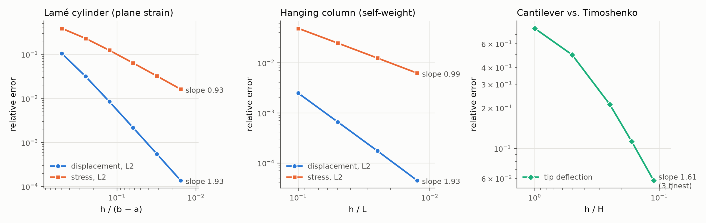
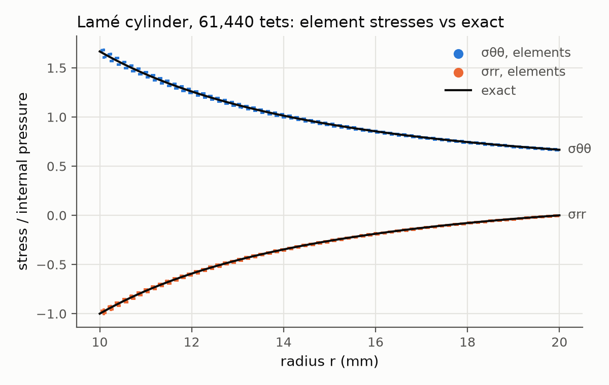

# Verification of the finite-element solver

This document records how the production solver (`craniofea.fem.jax_solver`)
is verified, and what it costs. Every number below was produced by

```bash
python scripts/verify_fem.py      # analytic cases, reference agreement, gradients, figures
python scripts/benchmark_fem.py --sizes 100k 850k --methods amg jax-cg
python -m pytest tests/test_fem_*.py          # the same checks as assertions (add -m "not slow" for CI)
```

on WSL2 Ubuntu 22.04 (Python 3.12, NumPy 2.5, SciPy 1.18, PyAMG 5.3,
JAX 0.11 in float64), 20 logical CPUs shared with other jobs, 7.7 GB RAM, NVIDIA RTX 3050 Ti Laptop GPU (4 GB). Timings are wall-clock and
include contention from concurrent work on the same machine.

## Discretisation

Linear tetrahedra (tet4 / C3D4) with one-point (exact) integration,
`K_e = V_e B_e^T C_e B_e`, with a full anisotropic Voigt stiffness `C_e` per
element in global axes (`[xx, yy, zz, yz, xz, xy]`, engineering shear).
Loads are consistent: `p A / 3` per node of a loaded boundary triangle along
the inward normal, `rho V g / 4` per element node, plus nodal forces.
Homogeneous Dirichlet dofs are decoupled (rows and columns zeroed, diagonal
kept), which is algebraically identical to eliminating them. Inhomogeneous
values can be prescribed through `JaxSolver.solve(problem, prescribed=...)`
(used by the patch test).

Linear solvers:

* **`amg`** (default): 3x3-block BSR assembly from jitted JAX element kernels,
  PyAMG smoothed aggregation with the six rigid-body modes as near-nullspace,
  preconditioned CG to `||f - K u|| / ||f|| <= 1e-10`. For models with
  compliant layers the preconditioner adds rigid-body-mode deflation of the
  stiff components (A-DEF2; Tang et al. 2009, Jönsthövel et al. 2009), see
  [High-contrast convergence](#high-contrast-convergence).
* **`jax-cg`**: matrix-free `K u` (gather, constitutive update, scatter-add)
  inside a `lax.while_loop` CG with 3x3 nodal block-Jacobi preconditioning;
  runs on the GPU when one is visible.

## Analytic verification



Errors are relative L2 norms over the discrete domain, integrated with a
64-point collapsed-coordinate Gauss rule per element (exact to degree 5).
Stress errors compare the element-constant stress with the exact field.
Linear tetrahedra should give O(h²) displacement and O(h) stress.

### Lamé thick-walled cylinder

Internal pressure `p` on a cylinder `a = 10 mm`, `b = 20 mm`, plane strain,
`E = 1 GPa`, `nu = 0.3`. Exact solution (Timoshenko & Goodier, sec. 28) with
`A = p a² / (b² - a²)`:

```
u_r      = (1 + nu) A / E * ((1 - 2 nu) r + b² / r)
sigma_rr = A (1 - b² / r²),   sigma_tt = A (1 + b² / r²),   sigma_zz = 2 nu A
```

The mesh is a structured `(r, theta)` box mapped onto a quarter annulus, so
the curved boundaries are faceted and the geometry error is part of the
measured error. Symmetry conditions are axis-aligned: `u_y = 0` on
`theta = 0` (`y = 0`), `u_x = 0` on `theta = pi/2` (`x = 0`); plane strain by
`u_z = 0` on every node.

| level | tets | dofs | h (m) | L2 error u | L2 error stress | CG it |
|---|---|---|---|---|---|---|
| 1 | 60 | 108 | 5.000e-03 | 1.053e-01 | 3.901e-01 | 1 |
| 2 | 240 | 330 | 2.500e-03 | 3.171e-02 | 2.309e-01 | 1 |
| 4 | 960 | 1,134 | 1.250e-03 | 8.489e-03 | 1.240e-01 | 1 |
| 8 | 3,840 | 4,182 | 6.250e-04 | 2.176e-03 | 6.378e-02 | 16 |
| 16 | 15,360 | 16,038 | 3.125e-04 | 5.490e-04 | 3.227e-02 | 18 |
| 32 | 61,440 | 62,790 | 1.563e-04 | 1.377e-04 | 1.622e-02 | 24 |

Fitted rates over all levels: **1.93** (displacement) and **0.93** (stress);
between the two finest meshes 1.99 and 0.99. (CG needs a single iteration
on the coarsest meshes because the whole problem fits on the AMG coarse
level, which is solved directly.)



### Hanging column

A `0.1 x 0.1 x 1 m` column hangs from its top face (`u_z = 0`) under gravity,
`E = 10 MPa`, `rho = 1000 kg/m³`, `nu = 0`, with symmetry rollers on `x = 0`
and `y = 0`. The exact solution is uniaxial, `sigma_zz = rho g z`,
`u_z = -rho g (L² - z²) / (2 E)`.

| level | tets | dofs | h (m) | L2 error u | L2 error stress | CG it |
|---|---|---|---|---|---|---|
| 1 | 60 | 132 | 1.000e-01 | 2.483e-03 | 4.884e-02 | 1 |
| 2 | 480 | 567 | 5.000e-02 | 6.589e-04 | 2.474e-02 | 1 |
| 4 | 3,840 | 3,075 | 2.500e-02 | 1.741e-04 | 1.245e-02 | 13 |
| 8 | 30,720 | 19,683 | 1.250e-02 | 4.492e-05 | 6.242e-03 | 17 |

Rates: **1.93** (displacement), **0.99** (stress).

### Cantilever against Timoshenko beam theory

Square section `H = 0.1 m`, `L / H = 10`, `E = 1 GPa`, `nu = 0.3`, clamped at
`x = 0`, tip load `P` applied as a uniform shear traction on the free end.
Reference: `delta = P L³ / (3 E I) + P L / (kappa G A)` with Cowper's
`kappa = 10 (1 + nu) / (12 + 11 nu)`; the shear term is 0.8 % of the total.
`level` is the number of elements through the depth (`10 level x level x level` hexes,
6 tets each). Deflection is the mean `u_z` over the tip face.

| level | tets | delta / delta_Timoshenko |
|---|---|---|
| 1 | 60 | 0.2194 |
| 2 | 480 | 0.5038 |
| 4 | 3,840 | 0.7873 |
| 6 | 12,960 | 0.8871 |
| 9 | 43,740 | 0.9421 |

Linear tetrahedra are notoriously stiff in bending (shear locking), so
convergence is from below and slow in absolute terms (error against beam
theory decreasing as h^1.61 over the three finest meshes). Richardson
extrapolation from the three finest meshes (observed order 1.47) gives
`delta_inf / delta_Timoshenko = 1.0096`: the converged 3D solution lies
1 % above beam theory, consistent with the root flexibility of a 3D clamp
that beam theory ignores. For the anatomical models this is the main
practical caveat of tet4: bending-dominated thin plates need several
elements through the thickness (or quadratic elements, see the CalculiX
cross-check backend).

### Patch test and uniaxial bar

* **Patch test**: unit cube, 4x4x4 hexes split into 384 tets, interior nodes
  jittered by up to 30 % of `h`, homogeneous anisotropic material (rotated
  orthotropic, 9 independent constants). Boundary nodes are given an
  arbitrary affine displacement `u = G x + c` (non-symmetric `G`). The
  interior displacement reproduces the affine field to 2.4e-15 (`amg`) /
  7.1e-14 (`jax-cg`) relative, and every element strain equals `sym(G)` to
  1.7e-14 / 1.4e-12.
* **Uniaxial bar** under end pressure with roller supports: stress, strain
  energy density, end shortening and lateral Poisson expansion exact to
  1e-9 (tested for both methods).

## Agreement with the direct reference solver

`craniofea.fem.reference` is an independent NumPy/SciPy implementation
(dense element matrices, true dof elimination, SuperLU). On a 432-tet box
with per-element random orthotropic constants (E 5-20 GPa, G 2-6 GPa),
uniformly random material rotations, random density, a clamp plus a
partial roller, and three load cases (uniform plus per-face pressure,
gravity, random nodal forces), solving with `rtol = 1e-13`:

| method | load case | rel. error u | rel. error stress | CG it |
|---|---|---|---|---|
| amg | pressure | 3.2e-14 | 3.2e-14 | 2 |
| amg | gravity | 2.8e-14 | 3.0e-14 | 2 |
| amg | nodal | 1.1e-14 | 2.7e-14 | 1 |
| jax-cg | pressure | 9.7e-15 | 1.5e-14 | 114 |
| jax-cg | gravity | 8.3e-15 | 1.2e-14 | 112 |
| jax-cg | nodal | 1.0e-14 | 5.4e-14 | 113 |

The tests additionally check that the JAX element matrices equal the
reference ones to 1e-12, annihilate rigid motions, that the matrix-free
operator equals the assembled matrix, and that assembly does not depend on
the chunk size.

## Gradients

`make_differentiable_solver(problem)` returns a JAX-traceable map
`(modulus_scale (M,), load_scale (n_cases,)) -> {u, strain, stress, sed}`.
Reverse-mode derivatives use the adjoint method: one extra solve
`K lambda = dL/du` per load case with the same preconditioner (K is
symmetric), then `dL/ds_e = -V_e eps(lambda)_e . C_e eps(u)_e` and
`dL/df = lambda`. For `L = 1e5 sum(w . u) + 1e-3 sum(sed)` on a 216-tet
heterogeneous orthotropic model with random `s` in [0.5, 1.5], the
directional derivative along a random direction agrees with central finite
differences (`h = 1e-4`) to **2.4e-9** (`amg`) and **2.3e-9** (`jax-cg`)
relative. The tests also check individual element derivatives,
load-scale derivatives, `jax.jit` compatibility and the exact scaling
`u(c s) = u(s) / c`.

## High-contrast convergence

The maxillary models combine cortical bone (15-20 GPa), cancellous bone
(~0.5 GPa) and sutures (~50 MPa). The benchmark model
(`verification.layered_box`) reproduces this: a 70 x 50 x 40 mm box with a
two-element stiff shell (17 GPa), a soft core (0.5 GPa) and a two-element
50 MPa slab cutting through shell and core at mid-length, clamped at one
end. Plain smoothed aggregation handles the shell/core contrast well, but
the slab splits the model into two stiff pieces whose relative rigid
motions cost almost no energy; these modes are poorly represented by the
AMG coarse spaces. CG iterations to `rtol = 1e-10` at 105k tets:

| material | AMG-CG iterations |
|---|---|
| uniform 17 GPa | 27 |
| shell 17 GPa / core 0.5 GPa | 41 |
| shell / core / 50 MPa slab | 229 |
| same, with stiff-component deflation (default) | 86 |

The solver finds the stiff components automatically (connected components
of elements with `tr C >= 0.01 x` the 99th percentile) and uses their
rigid-body modes as deflation space; it is inactive for models with a
single stiff component. A strength threshold `theta > 0`, energy-minimising
prolongation and W-cycles were also tried and gave no consistent gain.

## Performance

`scripts/benchmark_fem.py` solves the layered high-contrast box
(`verification.layered_box`, 17 GPa / 0.5 GPa / 50 MPa) with two load cases
(top pressure plus gravity; side pressure) to `rtol = 1e-10`. Each
configuration runs in a fresh process; peak RSS is that process's maximum
resident memory (including the JAX runtime, about 0.6 GB). Assembly, AMG
setup and deflation are done once and shared by both load cases.

| model | tets | nodes | dofs | method | assembly | setup | solve per case | CG it | total (2 cases) | peak RSS |
|---|---|---|---|---|---|---|---|---|---|---|
| 35 x 25 x 20 hexes | 105,000 | 19,656 | 58,968 | amg (CPU) | 0.7 s | 0.5 s | 4.7 / 6.6 s | 86 / 124 | 13.2 s | 0.88 GB |
| 35 x 25 x 20 hexes | 105,000 | 19,656 | 58,968 | jax-cg (GPU) | - | 4.4 s | 12.8 / 10.6 s | 1496 / 1512 | 29.0 s | 1.03 GB |
| 70 x 50 x 40 hexes | 840,000 | 148,461 | 445,383 | amg (CPU) | 2.9 s | 5.9 s | 25.5 / 26.2 s | 56 / 57 | **62.8 s** | **2.11 GB** |
| 70 x 50 x 40 hexes | 840,000 | 148,461 | 445,383 | jax-cg (GPU) | - | 2.7 s | 122.5 / 116.9 s | 2886 / 2893 | 244.1 s | 1.75 GB |

"Setup" is the AMG hierarchy plus deflation space (`amg`) or the nodal
block-Jacobi inverse (`jax-cg`); the totals also include geometry
preparation, the sparsity pattern (cached for repeated solves on the same
mesh), JIT compilation and stress recovery. At 840k tets one complete
solve including assembly takes about 30 s on the CPU path, with a peak
memory of 2.1 GB.

The matrix-free GPU path converges to the same tolerance but is slower
here: block-Jacobi CG needs O(1/h) iterations (about 2900 at 445k dofs) and
the laptop GPU has low float64 throughput (about 41 ms per iteration at
840k tets). It remains useful when no host round trip is wanted
(`DifferentiableSolver(method="jax-cg")` keeps the whole map on the
device) and on data-centre GPUs with full float64 throughput.

A box mesh has fewer nodes per element (1:5.7) than a typical CT tet mesh
(about 1:4.7), so a CT model with the same number of tets has about 20 %
more dofs.

## References

* Bond, W. L. (1943). The mathematics of the physical properties of crystals. *Bell Syst. Tech. J.* 22, 1-72.
* Cowper, G. R. (1966). The shear coefficient in Timoshenko's beam theory. *J. Appl. Mech.* 33, 335-340.
* Jönsthövel, T. B., van Gijzen, M. B., Vuik, C., Kasbergen, C., Scarpas, A. (2009). Preconditioned conjugate gradient method enhanced by deflation of rigid body modes applied to composite materials. *CMES* 47, 97-118.
* Tang, J. M., Nabben, R., Vuik, C., Erlangga, Y. A. (2009). Comparison of two-level preconditioners derived from deflation, domain decomposition and multigrid methods. *J. Sci. Comput.* 39, 340-370.
* Timoshenko, S. P., Goodier, J. N. (1970). *Theory of Elasticity*, 3rd ed. McGraw-Hill.
* Vaněk, P., Mandel, J., Brezina, M. (1996). Algebraic multigrid by smoothed aggregation for second and fourth order elliptic problems. *Computing* 56, 179-196.
